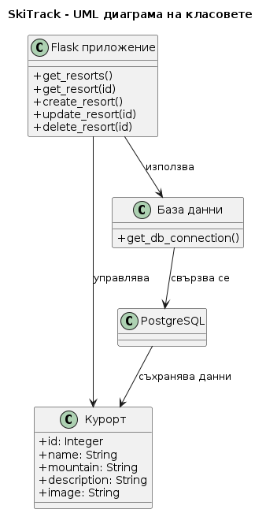

# SkiTrack – Документация на курсов проект

**Дисциплина:** Архитектурни модели за проектиране на софтуер

**Тема:** Разработка на уеб приложение за информация относно ски курортите в България

## 1. Въведение

SkiTrack е уеб приложение, предназначено за предоставяне на информация за ски курортите в България.

Приложението позволява на потребителите да разглеждат информация за различни ски курорти, включително тяхното наименование, местоположение, описание и изображения.

Основната цел на проекта е разработването на уеб система, която демонстрира използването на съвременни технологии за уеб разработка, релационни бази данни, контейнеризация и REST API.

## 2. Основни функционалности

SkiTrack предоставя следните функционалности:

- Преглед на списък със ски курорти.
- Преглед на подробна информация за отделен курорт.
- Добавяне на нов ски курорт.
- Редактиране на информацията за съществуващ курорт.
- Изтриване на ски курорт.
- Достъп до информацията чрез REST API.
- Съхранение на данните в PostgreSQL.

Приложението има информационен характер и не предлага функционалност за резервации.
## 3. Архитектура на системата

SkiTrack използва многокомпонентна уеб архитектура, реализирана чрез Docker Compose.

Системата включва следните основни компоненти:

### 3.1. Flask

Flask е Python уеб framework, използван за реализация на потребителския интерфейс и REST API.

Приложението обработва HTTP заявки и осъществява операции за създаване, четене, редактиране и изтриване на информация за ски курортите.

### 3.2. PostgreSQL

PostgreSQL е релационната система за управление на базата данни.

В нея се съхранява информация за ски курортите, включително идентификатор, име, планина, описание и изображение.

### 3.3. Docker Compose

Docker Compose се използва за стартиране и управление на контейнерите на приложението.

Системата включва два отделни уеб контейнера (`web1` и `web2`), контейнер с PostgreSQL, Nginx и Dozzle.

### 3.4. Nginx

Nginx функционира като обратен прокси сървър (reverse proxy) и разпределя входящите заявки между двата Flask контейнера.

По този начин се демонстрира балансиране на натоварването (load balancing).

Nginx осигурява и HTTPS достъп чрез самоподписан SSL/TLS сертификат, предназначен за учебната среда.

### 3.5. Dozzle

Dozzle е инструмент за наблюдение на логовете на Docker контейнерите.

Той е включен в архитектурата на проекта като отделна услуга за мониторинг. Настройката на удостоверяването изисква допълнителна проверка.

### 3.6. Архитектурна схема

Основният поток на заявките е:

**Потребител → Nginx → Flask (web1 / web2) → PostgreSQL**

Тази архитектура разделя отговорностите между обработката на заявки, приложната логика и съхранението на данните.
## 4. REST API

SkiTrack предоставя REST API за управление на информацията за ски курортите.

API използва HTTP методите GET, POST, PUT и DELETE. Данните се обменят във формат JSON.

### 4.1. API маршрути

| HTTP метод | Маршрут | Описание |
|---|---|---|
| GET | `/api/resorts` | Връща списък с всички ски курорти |
| GET | `/api/resorts/<id>` | Връща информация за конкретен курорт |
| POST | `/api/resorts` | Създава нов ски курорт |
| PUT | `/api/resorts/<id>` | Редактира съществуващ курорт |
| DELETE | `/api/resorts/<id>` | Изтрива ски курорт |

### 4.2. Структура на данните

Всеки ски курорт съдържа следните полета:

- `id` – уникален идентификатор.
- `name` – наименование на курорта.
- `mountain` – планина.
- `description` – описание.
- `image` – име на файла с изображението.

Примерен JSON обект:

```json
{
  "id": 1,
  "name": "Банско",
  "mountain": "Пирин",
  "description": "Ски курорт в България.",
  "image": "bansko.jpg"
}
```

### 4.3. HTTP статус кодове

REST API използва следните HTTP статус кодове:

| Код | Значение |
|---|---|
| 200 OK | Успешно получаване или редактиране на данни |
| 201 Created | Успешно създаване на курорт |
| 204 No Content | Успешно изтриване на курорт |
| 400 Bad Request | Невалидни входни данни |
| 404 Not Found | Курортът не е намерен |

### 4.4. Проверка на REST API

Функционалността на API е проверена чрез HTTP заявки с инструмента `curl`.

Успешно са проверени създаването, получаването, редактирането и изтриването на тестов курорт.

След приключване на проверките тестовият запис е изтрит и в базата данни остават пет основни ски курорта.
## 5. Тестване на приложението

За автоматизирано тестване на REST API на SkiTrack се използва Python библиотеката **pytest**.

Тестовете се намират във файла `tests/test_api.py` и изпращат HTTP заявки към приложението през HTTPS.

### 5.1. Автоматизирани тестове

Реализирани са шест автоматизирани теста:

| № | Тест | Проверявана функционалност |
|---|---|---|
| 1 | `test_get_resorts` | Получаване на списъка с петте ски курорта |
| 2 | `test_get_single_resort` | Получаване на информация за конкретен курорт |
| 3 | `test_get_nonexistent_resort` | Обработка на грешка 404 при несъществуващ курорт |
| 4 | `test_create_resort_validation` | Проверка на невалидни данни при POST заявка |
| 5 | `test_update_resort_validation` | Проверка на невалидни данни при PUT заявка |
| 6 | `test_delete_nonexistent_resort` | Обработка на грешка 404 при DELETE заявка |

### 5.2. Стартиране на тестовете

Тестовете се стартират от основната директория на проекта чрез командата:

```bash
python -m pytest tests/test_api.py -v
```

### 5.3. Резултати

При изпълнение на тестовете е получен следният резултат:

**6 passed**

Всички шест автоматизирани теста са преминали успешно.

Тестовете проверяват основни функционалности на REST API, обработката на грешки и валидирането на входните данни.

### 5.4. Допълнителни проверки

Освен автоматизираните тестове са извършени и ръчни проверки на:

- CRUD операциите чрез уеб интерфейса.
- CRUD операциите чрез REST API.
- Връзката с PostgreSQL.
- Разпределянето на заявките между двата Flask контейнера чрез Nginx.
- HTTPS достъпа със самоподписан сертификат
## 6. UML диаграма на системата

За визуализиране на структурата на SkiTrack е създадена UML диаграма с помощта на PlantUML.

Диаграмата представя основните логически компоненти на приложението:

- **Курорт** – представя данните за ски курорт.
- **Flask приложение** – обработва заявките и реализира CRUD операциите.
- **База данни** – осигурява връзката с PostgreSQL.
- **PostgreSQL** – съхранява информацията за курортите.

Диаграмата показва връзките между компонентите и начина, по който приложението взаимодейства с базата данни.

Тя представлява опростен логически модел на системата, а не точно представяне на реализирани Python класове.

### 6.1. UML диаграма



Изходният код на диаграмата се намира във файла `docs/class_diagram.puml`, а изображението – в `docs/class_diagram.png`.
## 7. Заключение

В рамките на курсовия проект беше разработено уеб приложението **SkiTrack**, предназначено за предоставяне и управление на информация за ски курортите в България.

При реализацията на проекта бяха използвани Python, Flask, PostgreSQL, Docker Compose и Nginx.

Разработената система предоставя:

- Уеб интерфейс за преглед и управление на ски курорти.
- CRUD функционалност с релационна база данни PostgreSQL.
- REST API с HTTP методите GET, POST, PUT и DELETE.
- Два Flask контейнера с балансиране на натоварването чрез Nginx.
- HTTPS достъп със самоподписан SSL/TLS сертификат.
- Автоматизирано тестване с pytest.
- UML диаграма на основните логически компоненти.

В Docker Compose конфигурацията е включен и инструментът Dozzle за наблюдение на контейнерните логове. Удостоверяването в неговия уеб интерфейс остава за допълнителна настройка.

Резултатите от проведените проверки показват, че основните функционалности на приложението работят успешно.

Проектът демонстрира практическото приложение на архитектурни принципи като разделяне на отговорностите, контейнеризация, използване на REST API и балансиране на натоварването.

В бъдеще SkiTrack може да бъде разширен с информация за ски писти, метеорологични условия и актуално състояние на снежната покривка.